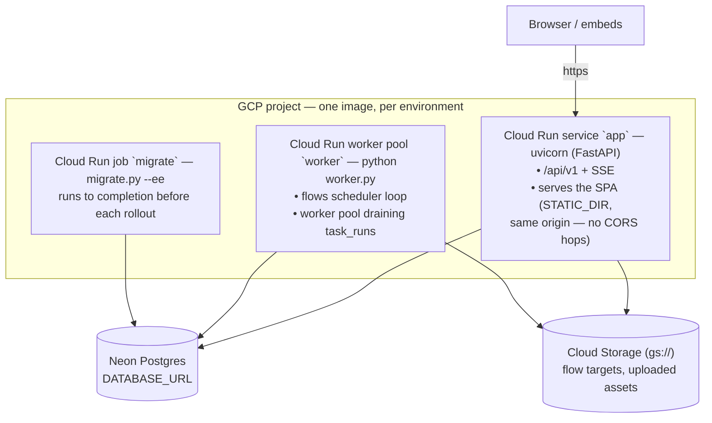

# Nubi Cloud

Nubi Cloud is the **managed, hosted** way to run Nubi. It is a deliberately
**thin layer** on top of the open-source project: the entire product — the
query workspace, dashboards, embedding, Flows orchestration, connectors,
pre-aggregations, AI, and MCP — is the same open-source code you can self-host.
Cloud only adds the things that genuinely require a managed operator.

## What Cloud adds (and self-host doesn't have)

Everything in this section is billing/subscription code — it ships in the
`ee/` tree in every clone of the repo, but is only **switched on** on Nubi
Cloud; a self-host deployment never activates it. The self-host database
schema never even creates these tables (the billing migrations live under
`database/migrations/ee/` and are applied only when the Cloud layer is
active).

- **Billing & subscriptions** — the five plans (Free, Starter, Team, Pro,
  Enterprise), collected via Paystack. See **[Billing, plans & usage wallet](/docs/billing-and-usage)**.
- **Usage wallet** — prepaid credits with manual and automatic top-up and spend
  caps, used to cover metered overages.
- **Overages & metering** — usage beyond your plan's quota (storage, compute,
  AI calls, embedded sessions, agent runs). Prices are **anchored in USD** and
  **billed in ZAR** at a daily-refreshed exchange rate.
- **Invoices** — monthly invoice PDFs (base subscription + overages + VAT where
  applicable), emailed and downloadable from your billing settings.
- **Managed infrastructure & SLA** — hosting, backups, scaling, and (on
  Enterprise) a contractual uptime SLA and dedicated support.

## What's identical to self-host

The product itself. Connectors, queries, parameters, dashboards, the Flows
builder, pre-aggregations, embedding, AI/chat, MCP, organizations, projects,
roles, secrets, and the security/embed-JWT model are the **same open-source
code** whether you run Nubi Cloud or host it yourself. Anything you learn in the
**Using Nubi** section applies to both.

## Cloud vs self-host at a glance

| Capability | Open-source self-host | Nubi Cloud |
|---|---|---|
| Full product (queries, dashboards, flows, embed, AI, MCP) | ✅ | ✅ |
| You operate infra, upgrades, backups | ✅ (your responsibility) | Managed |
| Subscriptions / plans / Paystack billing | — | ✅ |
| Usage wallet, overages, invoices, VAT | — | ✅ |
| USD-anchored pricing billed in ZAR (daily FX) | — | ✅ |
| Uptime SLA + dedicated support | — | ✅ (Enterprise) |

## How Nubi Cloud runs (architecture)

Nubi Cloud runs on **Google Cloud Run** in **`africa-south1` (Johannesburg)**,
one environment per branch (`dev`, `prod`; `qa` to follow). Every environment is
the same combined Docker image — the FastAPI backend with the built SPA embedded —
running as **two processes** plus a one-shot migration job:

- **`app`** — uvicorn serving the API *and* the built frontend from the same
  origin (the backend's static-SPA mode). All browser calls are same-origin, so
  cookies and embed sessions need no cross-origin setup. At least one instance
  is always warm so embeds and SSE streams get a fast first byte.
- **`worker`** — the standalone flows worker (scheduler tick + concurrent worker
  pool), always on, no HTTP. Scheduled flows and queued `task_runs` run here,
  never in the request path. Replicas lease `task_runs`, so scaling out is safe.
- **Postgres on Neon** — the only system of record, one branch per environment.
  Containers hold no state.
- **Object storage on Cloud Storage** — materialized flow targets (parquet) and
  uploaded assets live under `gs://` URIs, accessed with the runtime service
  account's identity; there are no static storage keys.
- **Migrations** — the forward-only runner (`database/migrate.py`) executes as a
  Cloud Run job before each rollout; the new revision only receives traffic once
  it has succeeded.
- **Secrets** — Secret Manager, one secret per variable per environment.
- **Git layer (env-as-branch)** — pushes to GitHub/GitLab go through the
  **provider APIs** (GitHub App installation token or GitLab access token).
  There is no server-side git working tree or daemon, so this too keeps the
  containers stateless and disposable.

### Deploy pipeline

Images are built **once, in this public repo**
([`.github/workflows/build-image.yml`](../.github/workflows/build-image.yml)) and
published to GHCR: `dev-<sha>` on every push to `dev`, `X.Y.Z` on release tags.
A private ops repository holds the Terraform and deploy workflow that mirrors a
published tag into the project and rolls it out — `dev` automatically, `prod`
after a reviewer approves. The digest that ran on dev is the digest that reaches
prod; nothing is rebuilt downstream.

**Self-hosting Nubi yourself?** Nothing in that pipeline is needed. The same
`Dockerfile` builds the free, full-featured self-host image; bring your own
orchestration (Docker Compose, Fly — see [`deploy/fly/`](../deploy/fly/README.md) —
Kubernetes, Cloud Run, …). See [`DEPLOY.md`](../DEPLOY.md).

## Pricing

Plans are anchored in **US dollars** and billed in **South African Rand** at a
daily-refreshed exchange rate (with a small buffer); your USD price anchor stays
fixed for the duration of your plan. The full breakdown — what's metered, the
usage wallet, overage rates, and invoices — is in
**[Billing, plans & usage wallet](/docs/billing-and-usage)**.

> Want to run everything yourself instead? See the **Open-source project**
> section, starting with **[Self-hosting](/docs/self-host)**.
